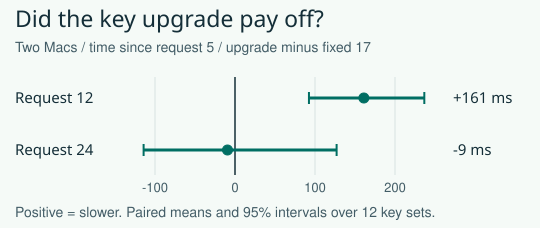

# Cryptography research portfolio · Rohit Suryadevara

When does sending fewer encryption keys make an application faster? How can a developer check an arithmetic implementation against an exact answer? This portfolio follows those two questions from experiment design to evidence you can run locally.

**[Encrypted inference study](research/conv-mnist-upgrade/README.md)** · **[Finite-field test vector](docs/FINITE-FIELDS.md)** · **[Artifact and reuse guide](docs/ARTIFACTS.md)**

## Featured study: when does uploading two more keys pay off?

A client sends an encrypted image to a server running a digit classifier. The server also needs *rotation keys*: they let it rearrange encrypted values without decrypting them. Starting with 17 keys makes the initial upload smaller. Sending two more after the fifth prediction can save work on later images. The practical question is how long the session has to last to recover that cost.

On one M5 Pro, with keys prepared in advance, the upgrade recovered its cost by **request 12** on average and stayed ahead through request 24. When an M5 Pro client sent the same workload to a separate MacBook Air evaluator, the upgrade was still **161 ms behind at request 12**. At request 24 it was 9 ms ahead on average, but the interval included both a loss and a gain. The single-machine cutoff did not transfer to this pair.



The two-Mac prepared-key run covered **12 independently generated client key sets and 1,152 predictions on eight distinct images**; every predicted class matched the reference. That checks the tested inputs, not classifier accuracy on new images. On the prespecified mix of short and long sessions, upgrading averaged **194 ms slower** than the fastest fixed policy (17 keys); its 95% interval ranged from 92 ms faster to 585 ms slower. The separate on-demand run has **2 of 4** completed blocks. No latency conclusion is drawn from that partial run.

**Use the result:** If you are choosing a key policy, measure the initial upload and cumulative response time on your own client/server connection before adopting a cutoff. The published [per-key timings](research/conv-mnist-upgrade/two-mac/prepared-prefixes.csv) let you check our paired comparisons. The [study](research/conv-mnist-upgrade/README.md) explains the clocks, model, session mix and uncertainty.

## Run an independent check

Clone the repository, then choose either check. Both run offline with Python 3.11+ and its standard library. No GPU, model download or cloud account is needed.

```sh
git clone https://github.com/rohit661x/alpoge-cloud-lab.git
cd alpoge-cloud-lab
```

**Replay the encrypted-inference study:**

```sh
python3 research/conv-mnist-upgrade/verify.py
```

A pass rebuilds the single-machine report from archived records and recalculates the two-Mac comparisons from 12 published rows. This does not run a fresh encrypted benchmark.

**Verify a finite-field certificate:**

```sh
python3 goldilocks_order.py
```

The expected order is `340282366762482138508632908526633615363`. The [worked example](docs/FINITE-FIELDS.md) gives a coefficient triple you can use to test another implementation.

## Other work in this repository

- **Exact arithmetic:** [Derivation, witnesses, and prior work](research/RESULTS.md) for the cubic field also used in Plonky3. The certificate establishes an algebraic order; it makes no performance or protocol-security claim.
- **Computational number theory:** [Python examples and formal verification notes](docs/NUMBER-THEORY.md) cover quadratic forms, prime-count bounds, and selected finite constructions associated with Alpöge’s work. The encrypted-inference results and finite-field certificate do not depend on the Riemann hypothesis.
- **Earlier encrypted-computation experiments:** The [release guide](docs/ARTIFACTS.md#earlier-encrypted-computation-releases) identifies which BFV stencil, filter-bank and ResNet20 results were measured, which were estimated, and how to replay each.

## Authorship, citation and feedback

Rohit Suryadevara maintains this collection. Research preparation and code for the featured study were predominantly AI-generated; the linked artifacts show what readers can check independently. When citing a timing, identify the study, hardware, cohort and exact commit. Use GitHub’s **Cite this repository** action for the collection, and the [artifact guide](docs/ARTIFACTS.md) for model credits, dataset terms and reuse.

Reproduced a different result? [Open an issue](https://github.com/rohit661x/alpoge-cloud-lab/issues/new) with the command, commit, Python version, and the first output that differs. A measurement from another machine pair is especially useful if it specifies the connection, timing boundaries and whether the keys were prepared in advance.
